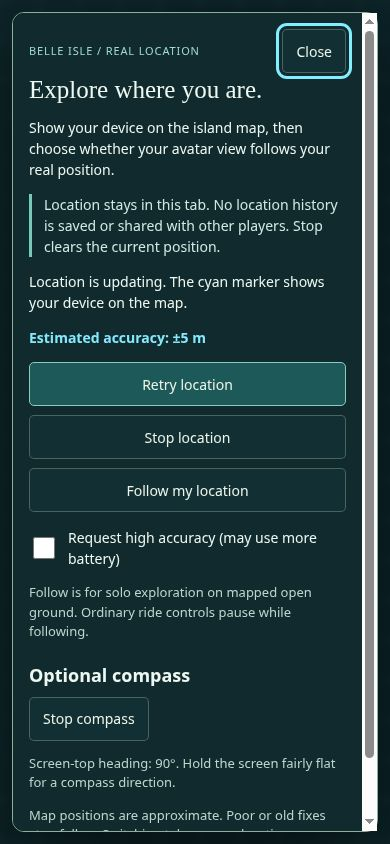
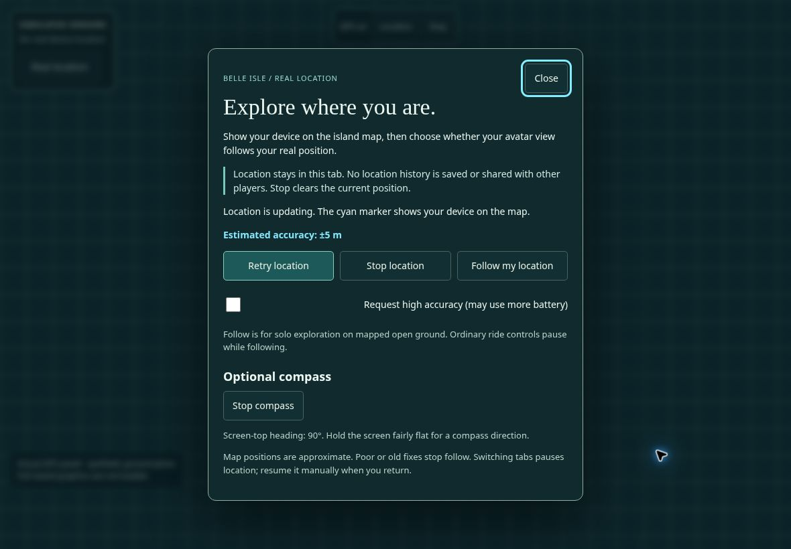

# Belle Isle GPS interface review — 2026-11-23

This record distinguishes rendered interface evidence, full-game CI evidence, and tests that still need physical hardware. The GPS implementation under review began at `c0191859cfa05754bec11fc81f3eaf2e3ab30f5f`. The development fixture and aggregate timing tools are included in the commit containing this record.

## Rendered GPS interface

The supported managed preview connected successfully. Cloud Chrome could load the game page but failed to create a WebGL context, including one ordinary retry. The real GPS panel was therefore rendered through `game/qa/gps-ui.html`, which imports the production panel, location/compass services and actual game styles. The development fixture uses Canvas 2D and explicitly labeled synthetic sensor data. Its frame denies native location/orientation permissions. It does not include the 3D island.

| Frame viewport | Observed result |
| --- | --- |
| 1280 × 800 desktop | Panel fits; no horizontal overflow; buttons at least 44 px high. |
| 390 × 844 phone | Panel fits with vertical scrolling; no horizontal overflow; buttons at least 44 px high. |
| 820 × 1180 tablet portrait | Panel fits without content overflow; buttons at least 44 px high. |
| 1180 × 820 tablet landscape | Panel fits without content overflow; buttons at least 44 px high. |
| 844 × 390 short landscape | Panel fits with vertical scrolling; no horizontal overflow; Stop remains operable. |

These are CSS viewport checks in desktop Chrome, not a claim that Safari or physical iPad hardware was tested.

Observed interaction checks:

- No watch exists before **Use my location**. The deliberate action starts one simulated watch.
- A usable fix enables **Follow my location**. Follow closes the panel and presents the persistent GPS-follow strip.
- Poor reported accuracy stops follow and disables its control.
- Denial clears the watch. A usable feed plus **Retry location** recovers.
- Simulated backgrounding stops follow and clears the watch. Returning remains paused until **Resume location**.
- Compass activation is separate. The synthetic east direction appears as 90 degrees.
- **Stop location** turns location and compass off, clears the position, and clears all started watches. The final observed count was zero active, three started, three cleared.
- Escape closes the modal; its close event restores focus to its actual opener. Focus outlines and 44 px controls remain present.
- With reduced motion enabled, the first-frame extra presentation gap was 0.000 m; the normal smoothed display showed a nonzero gap of 1.249 m. These are synthetic test distances, not a physical GPS accuracy measurement.

Exact measurements and production-module SHA-256 hashes are in [rendered-checks.json](rendered-checks.json).

### Captures

The following images show the actual rendered interface with **simulated sensor values**. The grid behind the panel is a fixture background, not an island screenshot.

## Full-game CI evidence

The original GPS candidate `c0191859…` was checked out as PR merge `16548f4bd90a871d48327bc32bc515643d82dea8`, merging it into production base `374b7a2…`.

- [HUD layout acceptance run 45276045932](https://github.com/robjasper2084/Jungle-Lotto/actions/runs/45276045932) passed both desktop and phone jobs. The phone job covers 390×844, 320×568, 390×340 and 844×390. Artifacts `belle-hud-layout-desktop` and `belle-hud-layout-phone` contain real 3D game screenshots, hit-target reports and hashes. Neither tests the GPS dialog.
- The same run completed TypeScript, the production build and the full test suite: 1,572 total, 1,569 passed, three skipped, zero failed; the separate asset stage passed 11/11.
- [Polish run 45276045958](https://github.com/robjasper2084/Jungle-Lotto/actions/runs/45276045958) passed desktop and phone cases with no reported page errors, failed requests or coverage gaps. Its simulated phone viewport is not a physical-device FPS certification.
- [Release evidence run 45276045116](https://github.com/robjasper2084/Jungle-Lotto/actions/runs/45276045116) passed phone input/timing and golden-reference cases. Golden-reference capture does not certify visual similarity to a reference image.

Downloaded artifact ZIP hashes were checked against their GitHub digests. Layout screenshots establish actual rendering and control behavior, not smooth gameplay. The sustained full-scene Metal performance workflow is the relevant separate measurement lane. Queued or running jobs must not be reported as passes, and each report must be matched to its source revision.

### Final integration and the new GPS measurement phase

The final source includes production PR #209 (`3e68163e94d173395cf7a2f47bd37859cf1a3f47`): Cadillac wire rims, tire/road contact and animated shadows. The ordinary road-aligned presentation and immediate GPS Stop restoration now share a nonmutating helper. Focused integration/presentation/timing checks passed 23/23; typechecking and the local production build passed. Two baseline fixtures removed by the sparse-checkout merge were restored, and all 15 tests in their three affected files plus 11 asset tests passed. Final complete-suite counts must be taken from the subsequent CI run, not inferred from the earlier candidate.

Full-mode sustained CI retains the original riding acceptance gate and adds the real GPS panel and three distinct 30-second captures after returning to the authored Jefferson start: location off, marker on and follow on. Browser-emulated public coordinates are kept fresh in the isolated test context; no real device location or compass is requested. Reports check actual minimap marker cleanup, normal control recovery, unchanged viewport/settings and a strict coordinate-free aggregate schema. Outputs are `gps-regression.json`, `gps-off-timing.json`, `gps-marker-timing.json`, `gps-follow-timing.json` and screenshots in the existing full-mode artifacts. Their results remain unverified until that exact candidate's jobs finish.

## Physical follow-up

The opt-in `?locationPerf=1` recorder now measures successful render submissions during GPS follow without collecting coordinates. See [REAL_LOCATION.md](../../game/REAL_LOCATION.md) for its limitations and controls.

On the physical phone/iPad, check the deployed HTTPS URL: allow/deny/retry location, standing still, walking, poor signal, portrait/landscape rotation, optional compass, background/resume, Stop, vehicle/activity/multiplayer exclusions and return to ordinary riding. Run separate 30/60-second timing captures for location off, marker on and follow on with the same graphics settings. Field battery/thermal and compass alignment checks remain manual.

No actual device sensor accuracy, physical iPad performance, battery life or full-island GPS-follow performance is certified by this fixture. The user authorized merge/publication after available checks; live status must be verified from the production deployment and exact-version public verification workflow.
